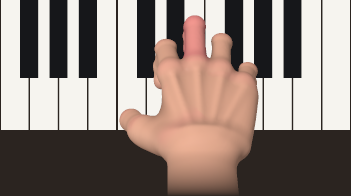

# 3D 绑骨钢琴手（右手）

一只带骨骼的写实右手，能在网页上的琴键上弹：手指按键、要弹的手指提起来变红、弹对闪绿、整只手换手位时抬起平移。最早给「听音钢琴课」用，也可以单独拿去别的项目。



## 文件

- right-hand.glb`：手的模型（glTF 2.0 二进制，单位米）。22 根骨骼：`forearm`、`hand`，`thumb1-3`、`index1-3`、`middle1-3`、`ring1-3`、`pinky1-3`，每根手指末端还有 `*Tip`。每根骨骼局部 -Z 顺着手指，+Y 朝指甲。顶点带肤色和预烘的阴影（COLOR_0），还有 `_FINGER`（第几指 1-5、权重）用来给单根手指上色。Blender 等软件可以直接导入。
- piano-hand.js`：动作模块（需要 three.js r160 以上）。
- demo.html`：演示页，可以点按钮换手位、选手指、弹五指音阶。
- `src/build-hand.mjs`：生成模型的脚本（距离场建模 + 自动蒙皮权重），改手指长短粗细后重新跑：`node build-hand.mjs right-hand.glb 0.16`（最后的数字是网格精度，厘米）。
- `src/preview.mjs`：不用浏览器的离线预览，出一张手放在键盘上的 PNG。

## 用法

```html
<script type="importmap">{"imports":{"three":"https://cdn.jsdelivr.net/npm/three@0.170.0/build/three.module.js","three/addons/":"https://cdn.jsdelivr.net/npm/three@0.170.0/examples/jsm/"}}</script>
<script type="module">
import { PianoHand } from './piano-hand.js';
// container：盖在 HTML 琴键上的一个 position:absolute 的框，左右和键盘对齐，下面多留几十像素放手腕
const hand = await PianoHand.create({ container, whiteKeys: 12, keyboardHeight: () => kb.clientHeight });
hand.moveTo(4);       // 拇指放在第 4 个白键（最左边是 0），其余四指依次往右
hand.highlight(3);    // 下一个要弹的手指：微微抬起、变红
hand.press(3);        // 按下去，闪绿；hand.press(3, { color: 'miss' }) 闪橙色
hand.play(5, { delay: 0.5, duration: 0.4 }); // 预先安排的一下（先抬指再落下），做示范用
</script>
```

`PianoHand.create` 在没有 WebGL2、模型下载失败或着色器编译失败时会报错，接住它就可以退回 2D 画法。其他选项：`labels`（指尖上的 1-5 数字，默认开）、`shadows`、`maxPixelRatio`、`keyLength`（把琴键看成多长，决定俯视角度）、`pose`（覆盖 `DEFAULT_POSE` 里的手型参数，比如手腕高度、每个关节的弯曲）。

坐标：一个白键宽 = 1。相机是倾斜的正交相机，琴键平面正好对上 HTML 琴键，所以指尖落在哪个键的中间是算出来的（每根手指用小的逆运动学求解），换屏幕尺寸也对得上。

## 动作

- 休息手型：手指弯成「握着一个球」，指尖落在五个白键中间，手背略向小指侧倾。
- 按键：掌指关节和中间关节一起往下，指尖关节保持稳；手腕跟着轻轻一沉、往按键那边转一点，旁边两根手指稍微带一下。
- 换手位：整只手先抬起，平滑移过去再落下，距离越远时间稍长。
- 平时有很轻的呼吸感微动。所有关节用弹簧阻尼跟随，动作是连续的，不会跳。

## 来源和授权

模型完全由 `build-hand.mjs` 用代码生成，没有用任何第三方模型或贴图，归你所有，想开源可以自己选授权（比如 CC0）。three.js 是 MIT 授权，从 CDN 加载。
